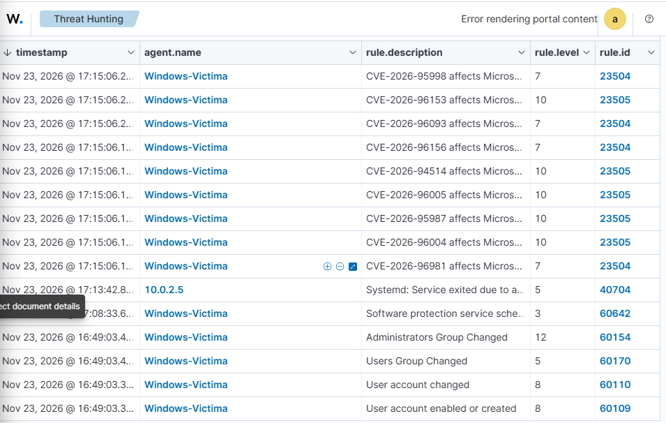
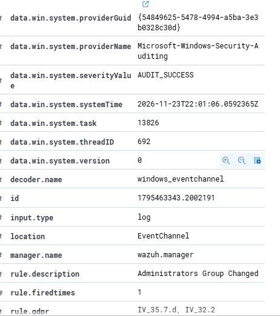
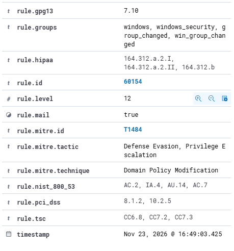

# Incident #03: Unauthorized Local Admin Account Creation on Windows (Persistence)

* **Date / Time:** 2026-11-23 22:04:00 UTC (23:04:00 CET - Spain / 19:04:00 ART - Argentina)
* **Affected Endpoint:** `Windows-Victima` (Windows 10 Pro - Agent ID `002`)
* **Windows Event IDs:** `4720` (User Account Created), `4732` (Member Added to Security-Enabled Local Group)
* **Triggered Rules:** Rule ID `60109` (Level 8), Rule ID `60154` (Level 12 - High)
* **Suspicious Account:** `soporte_oculto` (SID `...-1002`, added to local `Administradores` group)
* **MITRE ATT&CK:** Persistence / Privilege Escalation (`T1136.001` - Create Account, `T1484` - Domain/Tenant Policy Modification)
* **Final Verdict:** True Positive - Remediated

## 1. Alert Analysis & Log Investigation
During active monitoring of Windows Security Event Logs in Wazuh (`Threat Hunting -> Events`), a high-severity alert (`Rule 60154` - Level 12) triggered indicating a modification to the local Administrators group (`Event ID 4732`).



Filtering out the Level 12+ view revealed the preceding account creation event (`Event ID 4720` / `Rule 60109`). Inspecting `Document Details` (`data.win.eventdata`) confirmed user `benthilau` created the unauthorized local account `soporte_oculto` (`memberSid: S-1-5-21-...-1002`) and added it to the local `Administradores` group (`targetSid: S-1-5-32-544`).





## 2. Containment & Remediation
Verified that no authorized change management ticket existed for creating `soporte_oculto`. Executed immediate account removal on the affected endpoint (`Event ID 4726` logged upon deletion):
```powershell
net user soporte_oculto /delete
```

## 3. SOC Ticket Closure Note (Spanish / English)
> **ES:** Alertas de seguridad de Windows (`Event ID 4720` y `4732` - Regla `60154` Nivel 12) detectadas en `Windows-Victima` a las 22:04 UTC (23:04 CET). Se confirmó la creación de la cuenta no autorizada `soporte_oculto` (`SID ...-1002`) y su incorporación al grupo local `Administradores` (`S-1-5-32-544`). Sin ticket de cambio asociado. Se procedió a eliminar la cuenta del equipo (`Event ID 4726`). Cerrado como Verdadero Positivo - Remediado.
>
> **EN:** Windows Security alerts (`Event ID 4720` and `4732` - `Rule 60154` Level 12) triggered on `Windows-Victima` at 22:04 UTC (23:04 CET). Confirmed unauthorized creation of local user `soporte_oculto` (`SID ...-1002`) and privilege escalation to the local `Administradores` group (`S-1-5-32-544`). Verified no authorized change request existed. Removed unauthorized account from host (`Event ID 4726`). Closing as True Positive - Remediated.
